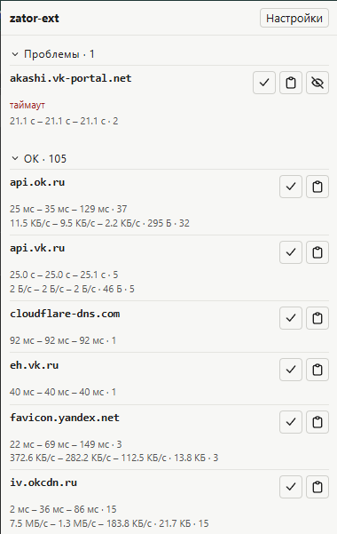
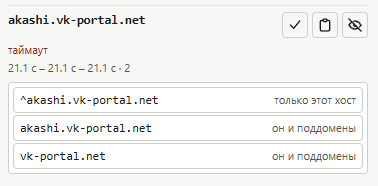

# zator-ext

Расширение для Chrome и Chromium-форков. Смотрит запросы **текущей вкладки** и раскладывает хосты по трём секциям попапа. Списки обхода берёт из [zator](https://github.com/AloofLibra/zator), на роутер ничего не пишет и в панель на порту 17682 не ходит.



Заголовок секции сворачивает её. У строки в Проблемах — короткая причина последнего обрыва (`таймаут`, `reset`, `обрыв`, `обрыв tls`, `обрыв http/2`, `обрыв quic`). Под именем — время завершённых запросов: минимум, среднее, хвост и сколько их было. Вторая строка появляется, только если сервер объявил Content-Length: скорость в том же порядке, затем медианный размер, затем сколько запросов вошло в скорость. Галочка помечает хост для проверки страницы. Иконка буфера открывает меню копирования. «Скрыть» есть только у Проблемы: хост уходит в Игнор и остаётся там, пока его не уберут в настройках.



Меню предлагает правила в том виде, в каком их вставляют в хостлист. Первым идёт самое узкое: `^хост` — только этот хост, строка без крышки — он и поддомены, дальше родительские домены с тем же охватом, но шире. Для `00.img.avito.st` это ещё `img.avito.st` и `avito.st`. Метку из одного куска и `*.example.com` меню не предлагает: zapret так не читает.


Пока проверка страницы идёт, на значке серым написано `попытка/всего`. В конце прогона на миг появляется зелёное `сколько прошло/сколько помечено` или красный `!`. Как только активная вкладка догрузится, значок снова показывает красным число хостов в Проблемах. «Сбросить значок» убирает текст и прогон не останавливает.

| Секция | Когда |
| --- | --- |
| ОК | Последний завершённый запрос хоста — ответ HTTP. Код любой, включая 400 и 500: сервер ответил, обход тут ни при чём. Если рядом были отмены, у строки метка `отменено N из M`: хост не кандидат в список, но красные `(canceled)` в Network не проглатываются |
| Проблемы | Соединение оборвалось, и после этого ответа не было: таймаут, reset, обрыв TLS, HTTP/2 или QUIC. Поздний обрыв перебивает ранний ответ; поздний ответ возвращает хост в ОК |
| Игнор | IP запроса есть в списке заглушек, либо домен скрыт вручную |

Имя, которое не резолвится, обрыв сети, отменённый запрос и обрыв блокировщиком сами по себе хост не показывают: это не кандидат в список. Отмена рядом с ответом HTTP остаётся на строке ОК меткой, а не переносит хост в Проблемы.

Если хост уже есть в скачанной копии списков, у строки метка `в обходе` или `в исключениях`. Это не галочка проверки. Попадание в исключения (`netrogat` и подстроки исключений) не лечит, а выключает обработку. Сверка идёт по правилам zapret: строка `youtube.com` покрывает `www.youtube.com`, строка `^host` покрывает только этот хост. Пока копию не обновили хотя бы раз, меток нет: RKN-лист в расширение не вшит.

Если документ вкладки не загрузился, а подресурс того же хоста ответил, строка может остаться в ОК с меткой `документ не загрузился`.

## Настройки

Открываются отдельной вкладкой, не в попапе.

- Проверка страницы. По умолчанию 2 попытки, пауза 5 секунд, таймаут загрузки 20 секунд. Допустимо: попытки 1–10, пауза 1–60, таймаут 5–60. Значение вне диапазона прогон не запускает.
- IP игнора. По умолчанию `0.0.0.0`, `::`, `127.0.0.1`. Только точный адрес, без маски сети. Хост, ушедший на такой IP, попадает в Игнор, даже если ошибка была таймаутом.
- Скрытые домены. Очищаются здесь. По одному из попапа не возвращаются.
- Известные списки zator. Семь списков: TCP/UDP YouTube, TCP RKN, Discord, исключения, подстроки RKN и подстроки исключений. Адрес каталога по умолчанию `https://raw.githubusercontent.com/AloofLibra/zator/zator`. Выключенный список метку не ставит. Неудачное обновление старую копию не затирает.

## Установка

`chrome://extensions` → режим разработчика → «Загрузить распакованное расширение» → папка с `manifest.json`.

Сборка не нужна. Журнал живёт в памяти фона: новый документ вкладки его стирает, закрытие вкладки тоже. Перезапуск фона обнуляет журнал, настройки и копии списков остаются.

Права:

| Право | Зачем |
| --- | --- |
| `<all_urls>` и `webRequest` | Видеть, какой хост на странице ответил, а какой оборвался. Иначе попап пустой |
| `tabs` | Понять активную вкладку и обновить её во время проверки |
| `storage` | Настройки, копии списков и пометки проверки |
| `alarms` | Пауза и таймаут проверки переживают засыпание фона |
| `clipboardWrite` | Заявлено для копирования правила |

Наружу уходит только скачивание списков с адреса каталога из настроек. Запросы страниц расширение никуда не отправляет.

## Проверка страницы

Галочка у строки помечает хост. Пометка переживает закрытие попапа и смену только хэша. Другой path её снимает. «Начать» появляется, когда помечен хотя бы один хост: несколько раз обновляет эту же вкладку и смотрит, явились ли помеченные хосты вместе. Второй прогон из другой вкладки не стартует: значок один на окно.

Зелёный итог — документ открылся и у каждого помеченного хоста ответов больше, чем обрывов, и ни одной неявки. Ничья, нулевой счёт и одна неявка дают «не прошёл». Хост, которого не было в журнале попытки, не считается ни успехом, ни обрывом.

Зелёный прогон значит только, что страница открылась в этом браузере. Он не значит, что сработала новая стратегия: браузер идёт другим путём, чем проверка с роутера.

## Чего расширение не делает

- Не отличает блок по имени от блока по IP. Таймаут выглядит одинаково.
- Не видит UDP и программы вне браузера.
- Не подтверждает заглушку `0.0.0.0`, если браузер не приложил IP к ошибке. Такой хост остаётся в Проблемах.
- Не добавляет домены в zator само. Скопированную строку вставляют в список руками.

## Разработка

Из этой папки:

```bash
npm test
```

Это `node --test test/*.test.js`. Node 18 или новее, зависимостей нет. Что автотест не открывает, перечислено в `test/MANUAL.md`.
